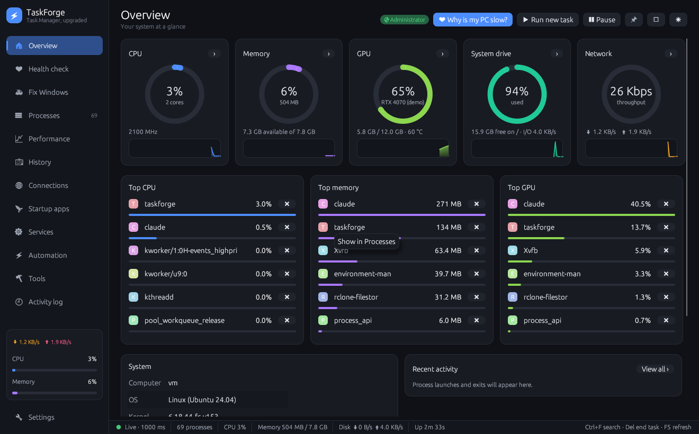
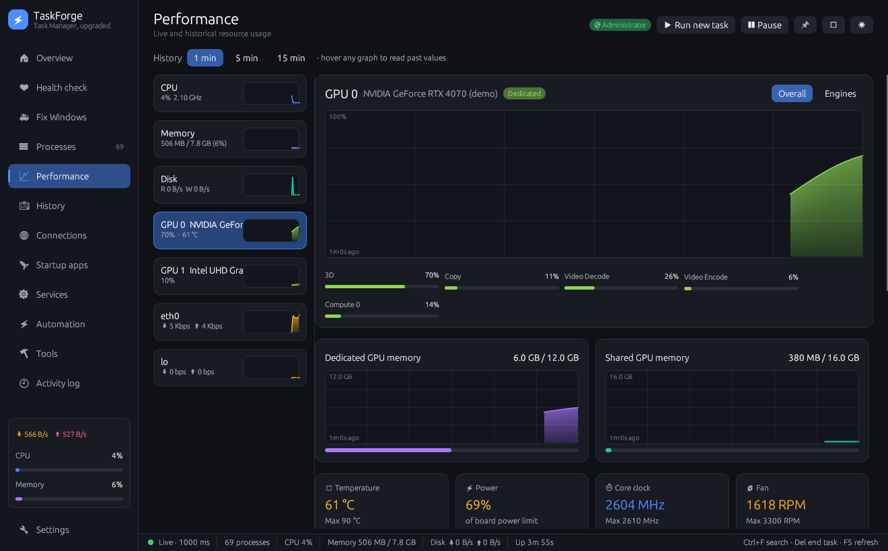
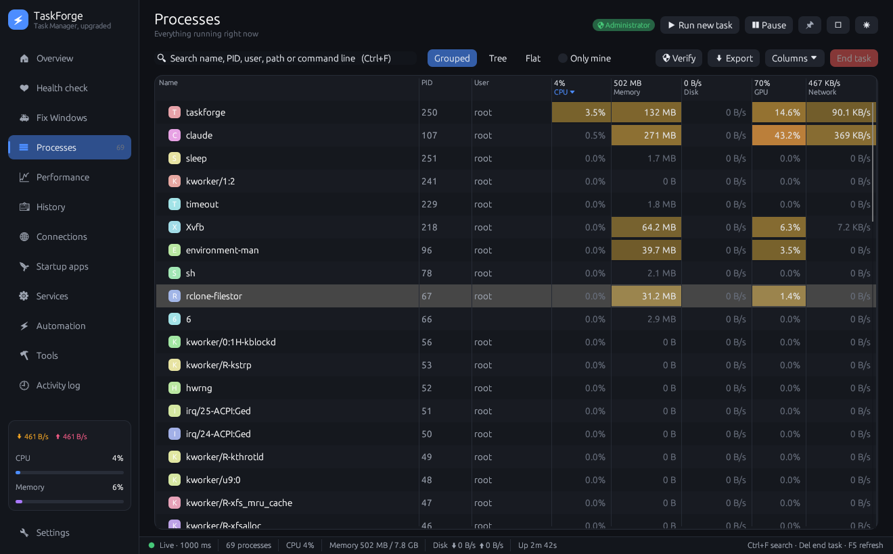
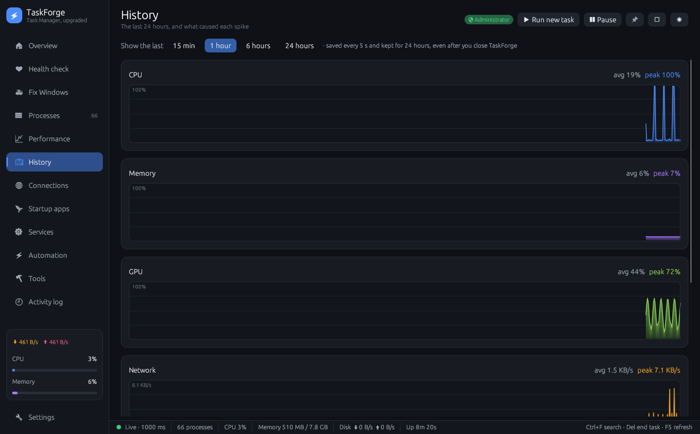
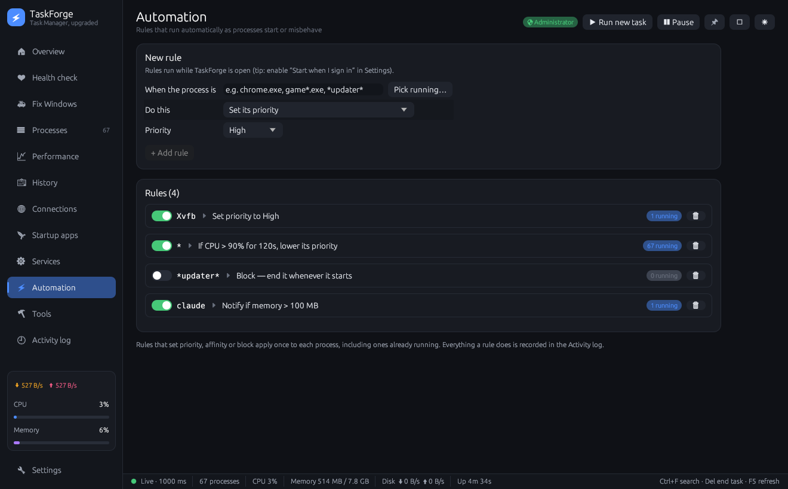
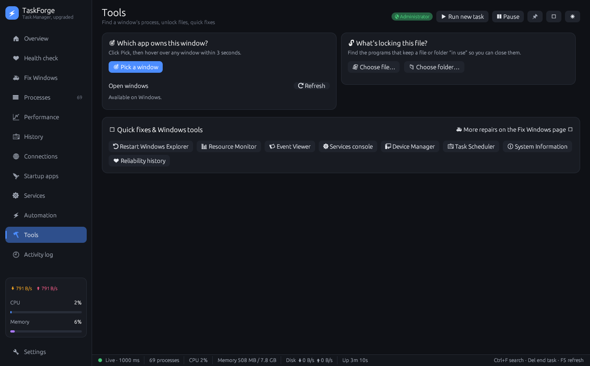
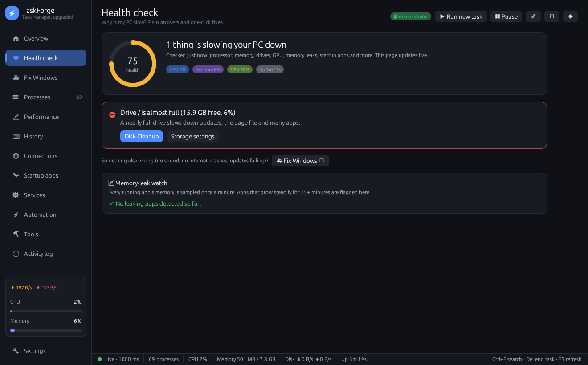
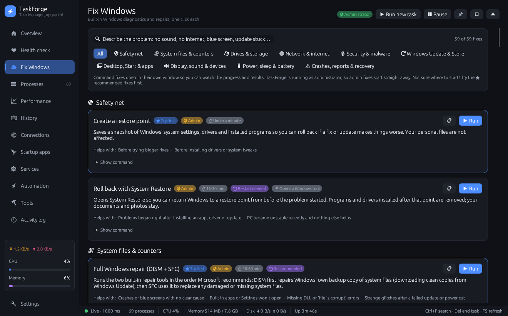
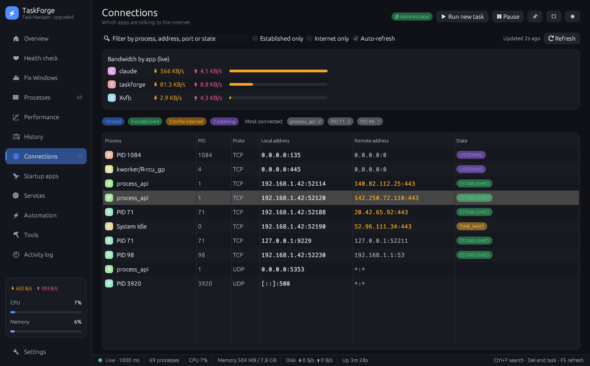
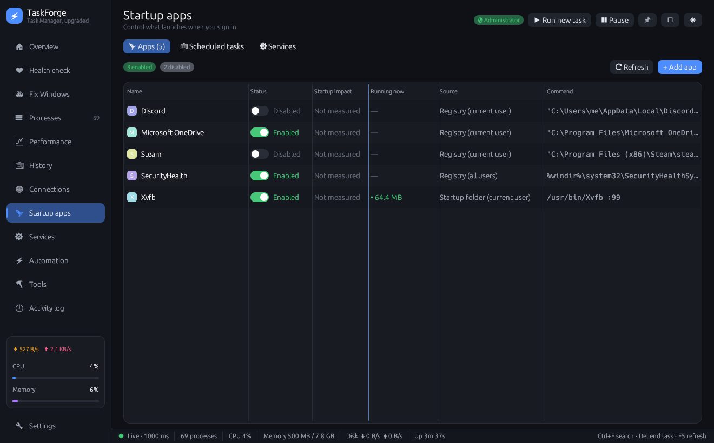

# TaskForge

A modern, faster-to-use Task Manager for Windows, written in Rust: detailed GPU monitoring, per-app network speed, a "Why is my PC slow?" health check, 59 one-click Windows fixes, 24-hour history and more.

**[⬇ Download the latest version](../../releases/latest)** · Free and open source (MIT)



## Install

1. Download **TaskForge-Setup.exe** from the [latest release](../../releases/latest) and double-click it.
2. If Windows shows "Windows protected your PC", click **More info → Run anyway** (the app isn't code-signed).
3. Click **Install**. Optionally tick *Create a desktop shortcut* and *Start when I sign in*.

TaskForge installs for your user account only (no admin prompt) into `%LOCALAPPDATA%\Programs\TaskForge`, adds a Start-menu shortcut, and appears in **Settings › Apps › Installed apps**, where you can uninstall it like any other app (or use *Settings › Installation › Uninstall* inside TaskForge). Prefer a portable app? Click **Run without installing**.

Tip: right-click TaskForge → *Run as administrator* (or use the in-app **Restart as admin** button) to manage system processes, services and all-users startup items.

## Build from source

Install Rust from <https://rustup.rs> (default MSVC toolchain), then in this folder:

```
cargo build --release
```

The exe is `target\release\taskforge.exe`; run it once and click **Install**.

**Releases are built by GitHub.** Every push builds and tests TaskForge on GitHub's Windows machines with Microsoft's compiler (`.github/workflows/build.yml`, see **Actions → Artifacts**). When you publish a release, the workflow attaches `TaskForge-Setup.exe` and a SHA-256 checksum to it automatically, so you don't need to upload the exe yourself.

Cross-compiling from Linux works with [cargo-zigbuild](https://github.com/rust-cross/cargo-zigbuild):
`TASKFORGE_LINK_RES=1 cargo zigbuild --release --target x86_64-pc-windows-gnu`.

## What's in it

**Everything the built-in Task Manager does**: processes, performance graphs, startup apps, services, end task, run new task, priority and affinity.

**Detailed GPU monitoring**
- Every GPU (dedicated and integrated) with overall load, using Task Manager's rule that a GPU's load is its busiest engine
- Live graphs for each engine (3D, Copy, Video Decode/Encode, Compute…)
- Dedicated and shared GPU memory, plus the memory budget Windows allows
- Temperature, power draw (% of limit), core clock, memory clock, fan speed, voltage, memory and PCIe bandwidth, wherever the driver reports them
- Per-process GPU %, the engine in use, and GPU memory, as columns and in the details panel
- GPU gauge on Overview, "Top GPU" list, and a GPU row in the mini monitor

**The most-requested extras**
| Feature | Where |
|---|---|
| Per-app network speed (⬇/⬆ per process, like Resource Monitor) | Processes "Network" column, Connections page. Needs admin |
| Suspend / resume a process | Right-click, or the details panel |
| Restart a process with the same command line | Right-click, or the details panel |
| Signature check for every program, plus a VirusTotal look-up (hash only, nothing uploaded) | 🛡 Verify button, Publisher column, details panel |
| Find what's locking a file or folder, and close it | Tools |
| Find which app owns any window (point at it) | Tools |
| Automation rules: auto priority/affinity, block apps, tame CPU hogs, CPU/memory alerts | Automation |
| 24-hour history saved between sessions, showing which process caused each spike | History |
| Thread list with suspend/resume/end, and full memory dump files | Details panel |
| Quick fixes: restart Explorer, open Resource Monitor, Event Viewer, Reliability history… | Tools |

**Version 1.1**
| Feature | Where |
|---|---|
| Health check: "Why is my PC slow?" with a 0–100 score, plain-English findings and one-click fixes (CPU/memory/GPU hogs, full drives, hot GPU, leaks, heavy startup apps, long uptime…) | Health check page, or the button on Overview |
| Memory-leak detector: every app sampled once a minute; steady growth for 15+ minutes gets flagged | Health check, details panel ("Memory trend") |
| Startup impact (High/Medium/Low), from CPU and disk use in each app's first minute after sign-in, using Windows' own thresholds | Startup apps → Impact column |
| Complete startup list: scheduled tasks that run at sign-in/boot, and third-party auto-start services | Startup apps → Scheduled tasks / Services tabs |
| System tray icon with live CPU/GPU bars, tooltip, and a menu (open, mini monitor, health check, end top CPU user, pause, quit); optional close-to-tray | Settings → Window |
| Error log and "Copy diagnostics" for bug reports | Settings → Diagnostics |

Rules and alerts now run in the background engine, so they keep working while TaskForge is minimised or in the tray.

**Version 1.5: fewer antivirus false alarms**

Antivirus software, including Microsoft Defender, judges unknown programs partly by how they behave. Version 1.5 removes the patterns that made TaskForge look suspicious:
- No more hidden PowerShell scripts. Services, scheduled tasks, shortcuts, install/uninstall and "Run as administrator" now use Windows' own APIs. The only PowerShell left is the signature check, which runs only when you click Verify, as a plain command with no encoding and no execution-policy override.
- The exe now carries proper program details (publisher, description, version under *Properties › Details*) and a standard Windows application manifest.
- TaskForge refuses to create memory dumps of core Windows processes (Windows blocks those anyway).
- "Find a saved Wi-Fi password" now opens Windows' own Wi-Fi settings instead of exporting passwords.
- Releases are built with Microsoft's compiler on GitHub and published with a SHA-256 checksum.

If Defender still flags a new release, report it to Microsoft as a false positive at <https://www.microsoft.com/en-us/wdsi/filesubmission> (choose *Software developer*). Code signing (for example the free SignPath Foundation program for open-source projects, or Azure Artifact Signing) removes most warnings for good.

**Version 1.4: 22 more fixes (59 in total)**
- Desktop, Start & apps: reset the Start menu, re-register built-in apps, fix copy & paste, clear File Explorer history & Quick Access, rebuild the font cache
- Network: find a saved Wi-Fi password, reset proxy settings, reset the hosts file (with backup), reset Windows Firewall, switch DNS to Cloudflare, Google or Quad9 (or back to automatic)
- New Security & malware section: Microsoft Defender quick scan and offline scan
- Rebuild performance counters, clear the Delivery Optimization cache, restart Bluetooth
- Reports & recovery: 60-second system performance report, save system info to your desktop, list blue-screen dump files, restart into the recovery menu (Safe Mode, Startup Repair, uninstall updates)

**Version 1.3: Fix Windows**

A new **Fix Windows** page (sidebar, under Health check) with built-in Windows diagnostics and repairs, each one click. Every fix explains what it does, lists the symptoms it helps with, and shows whether it needs admin rights or a restart and how long it takes. Type a symptom ("no sound", "update stuck", "blue screen") to find the right fix, or browse by category:

| Category | Fixes |
|---|---|
| Safety net | Create a restore point, System Restore |
| System files | Full repair (DISM + SFC), SFC, quick image check, clean up old update files |
| Drives & storage | CHKDSK scan / fix at restart, drive health (SMART wear, errors), delete temp files, Disk Cleanup, optimize drives |
| Network & internet | Step-by-step connection test, flush DNS, renew IP, reset Winsock/TCP-IP, Wi-Fi report, full network reset |
| Windows Update & Store | Reset Windows Update, reset Store cache, Windows troubleshooters |
| Desktop, Start & search | Restart Explorer, rebuild icon/thumbnail cache, fix Start search, rebuild search index |
| Display, sound & devices | Restart graphics driver, restart sound services, clear stuck print jobs, re-detect hardware, find devices with driver problems |
| Power, sleep & battery | What's stopping sleep, battery health report, power efficiency report, turn off Fast Startup |
| Crashes & hardware | Recent crashes and blue screens, memory (RAM) test, sync the clock |

Command fixes open in their own console window so you can watch the real output; admin fixes show the normal Windows permission prompt. Fixes with side effects (e.g. resetting network settings) ask you to confirm first, and 📋 copies the exact command if you'd rather run it yourself.

**Version 1.2: lighter and faster**
- About half the CPU use of 1.1, with fewer wake-ups (measured with the same test data on the same machine)
- The background sampler sleeps until the next tick instead of checking 20× a second, and its timing no longer drifts
- The window repaints once per sample (it used to repaint twice) and does one layout pass per frame
- Process names, paths and command lines are cached per process instead of being re-copied every second
- The process list is filtered and sorted only when data or the view changes, not on every frame
- Graphs and the 24-hour timeline draw at most one point per pixel
- The 24-hour history is appended to `history.jsonl` instead of being rewritten every minute, and saving happens outside the data lock
- Per-app network tracing asks Windows for only the 8 events it uses and reads them without schema parsing
- The tray icon sleeps until clicked and redraws only when the bars actually move
- Fixed: per-app history mixing when Windows reuses a process ID, a fake disk spike on newly started processes, and the UI briefly freezing while rules were saved

Pause now freezes only what you see. Rules, alerts, leak detection and history keep running in the background.

**Also included**: grouped/tree/flat process views, instant search, end process tree, pin apps, pause, 15-minute live graphs, per-app connections, activity log of launches/exits, load alerts, mini always-on-top monitor, startup "running now" column, service start-type editing, CSV export, a guard on critical processes, a one-click installer, and dark/light themes.

## Keyboard shortcuts

| Keys | Action |
|---|---|
| Ctrl+F | Search processes |
| Del / Shift+Del | End task / end process tree |
| Ctrl+R | Run new task |
| Ctrl+E | Export processes to CSV |
| Ctrl+P | Pause / resume live updates |
| Ctrl+M | Mini monitor |
| F5 | Refresh now |
| Ctrl+1 … Ctrl+9 | Switch page |
| Esc | Clear search / selection, close dialogs |

## Screenshots

| | |
|---|---|
|  |  |
|  |  |
|  |  |
|  |  |
|  |  |

(Captured on a Linux test machine with `TASKFORGE_DEMO=1`, which feeds sample GPU, network and Windows data through the same code paths.)

## How it works

```
src/
  main.rs            window setup, icon, --uninstall / --mini flags
  monitor.rs         background sampler: snapshots, live history, launch/exit log
  longterm.rs        24-hour history saved to disk, spike finder
  rules.rs           automation rules engine (pure logic, unit-tested)
  automation.rs      runs rules + alerts on the sampler thread (works while hidden)
  insights.rs        memory-leak detection and startup-impact measurement
  diagnose.rs        health-check findings and score (pure logic, unit-tested)
  repair.rs          Fix Windows catalogue: commands, descriptions, symptoms, script builder (unit-tested)
  diag.rs            log file, crash capture, diagnostics report
  tray.rs            system tray icon on its own thread (Windows)
  platform.rs        actions via built-in Windows tools (reg, sc, netstat, PowerShell) + parsers
  native/            direct Windows APIs through the official `windows` crate
    gpu_win.rs       GPU: DXGI + PDH GPU counters + D3DKMT sensors
    net_win.rs       per-app network via ETW (Microsoft-Windows-Kernel-Network)
    win.rs           suspend/resume, priority, affinity, threads, dumps, windows, Restart Manager
    fallback.rs      non-Windows equivalents + demo data for development
  app.rs             app state, shell layout, dialogs, alerts, jobs, shortcuts, settings
  ui/                pages: processes, overview + performance, gpu, history, tools + rules, system pages
build.rs             embeds the icon resource
docs/                project website (GitHub Pages) and screenshots
```

- **Smooth UI:** all sampling happens on a separate thread; the window only reads the latest snapshot. Slow lookups (services, connections, priority) run on worker threads too.
- **Careful native code:** Windows APIs are called through Microsoft's official `windows` crate. Every `unsafe` block has a SAFETY note, and every handle is closed automatically by a `Drop` guard. Command-line tools are still used where they're the simplest option. PowerShell scripts are passed with `-EncodedCommand`, so paths and names can't break quoting.
- **Libraries:** [`egui`/`eframe`](https://github.com/emilk/egui) for the GUI, [`sysinfo`](https://github.com/GuillaumeGomez/sysinfo) for system data, [`rfd`](https://github.com/PolyMeilex/rfd) for file dialogs.

Run the tests with `cargo test`.

## Known limits

- GPU temperature, fan, power and clocks come from the driver via WDDM 2.x. Some GPUs, often integrated ones, don't report them, and TaskForge says so.
- Per-app network speed needs administrator rights (Windows requires it for event tracing).
- Rules only run while TaskForge is open (including hidden in the tray). Enable "Start when I sign in" to keep them active.
- Startup impact is measured when TaskForge runs at sign-in, so enable "Start when I sign in" and it fills in after your next sign-in.
- Memory leaks need about 15 minutes of watching before an app can be flagged.
- Temperatures appear only where Windows exposes them (often needs admin).
- Settings, the log and the 24-hour history (`history.jsonl`) are saved in `%APPDATA%\TaskForge\data`.

## License

MIT
